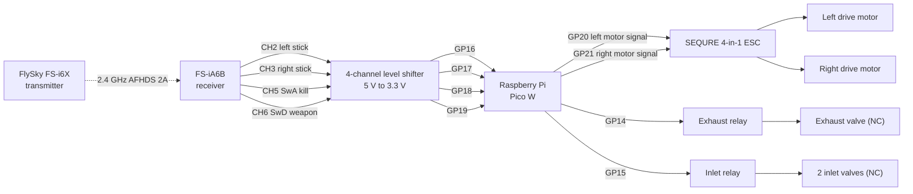

# RAMpage Signal Wiring

This is the signal wiring that `pico_direct.py` expects. If this file, the
README and the pin constants at the top of `pico_direct.py` ever disagree, the
code is what the robot actually does, so fix the other two.

Power wiring (battery, fuse, removable link, 12 V and 5 V converters) is not
shown here.

## Pin table

| Pico pin | Direction | Signal | Connects to |
|---|---|---|---|
| GP14 | out | Exhaust valve relay (active low) | Relay for the exhaust solenoid valve |
| GP15 | out | Inlet valves relay (active low) | Relay for both inlet solenoid valves |
| GP16 | in | CH2, left motor command | Receiver CH2 through the level shifter |
| GP17 | in | CH3, right motor command | Receiver CH3 through the level shifter |
| GP18 | in | CH5, kill switch (SwA) | Receiver CH5 through the level shifter |
| GP19 | in | CH6, weapon trigger (SwD) | Receiver CH6 through the level shifter |
| GP20 | out | Left motor signal, 50 Hz, 1000-2000 us | ESC left motor signal input |
| GP21 | out | Right motor signal, 50 Hz, 1000-2000 us | ESC right motor signal input |
| LED | out | Status LED | On-board (Pico W wireless chip) |
| GND | - | Common ground | Receiver GND, level shifter GND, ESC signal GND |

## What changed from the original build

In the original build (the one in the May 2025 final report), receiver CH2 and
CH3 were plugged straight into the ESC and only CH5 and CH6 went to the Pico.

1. Unplug the two ESC signal wires from receiver CH2 and CH3.
2. Connect receiver CH2 and CH3 to the two unused channels of the level
   shifter (5 V side), and the matching 3.3 V side to GP16 and GP17.
3. Connect the ESC left motor signal wire to GP20 and the right motor signal
   wire to GP21.

## To fill in on the robot

- TODO: which ESC motor inputs (M1 to M4) are the left and right motors.
- TODO: confirm the ESC is in bidirectional mode with 1500 us as neutral.
- TODO: transmitter failsafe: CH5 = ON (kill), CH2 and CH3 = center.
